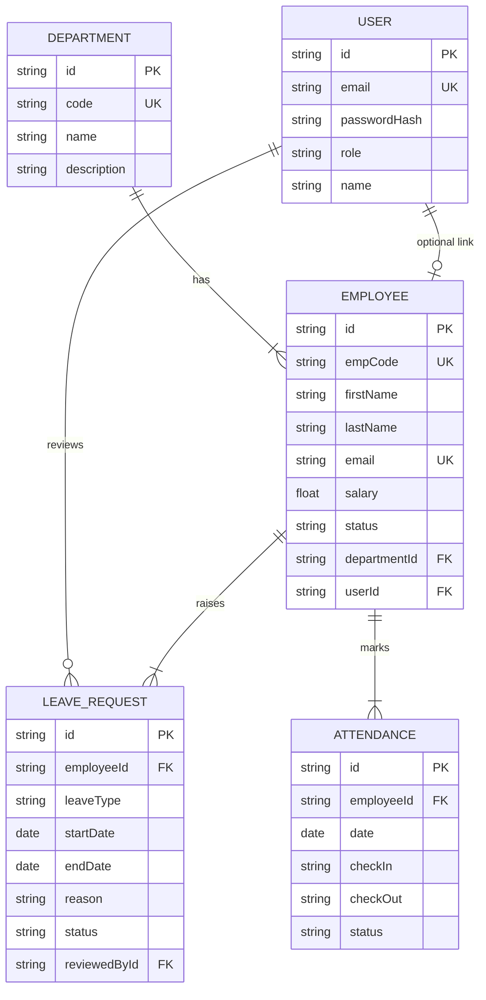
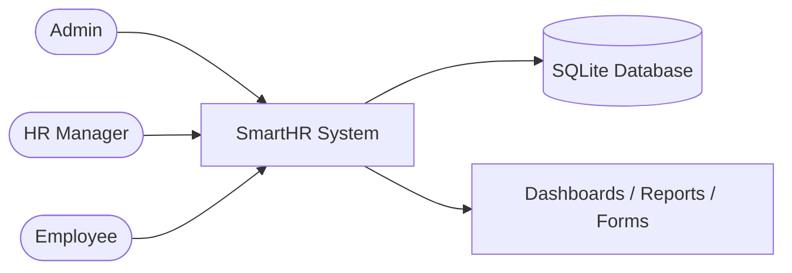
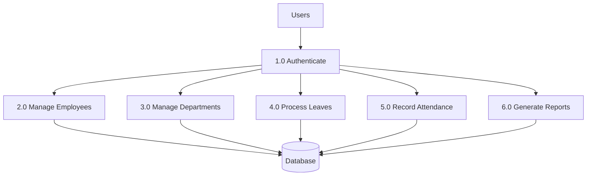
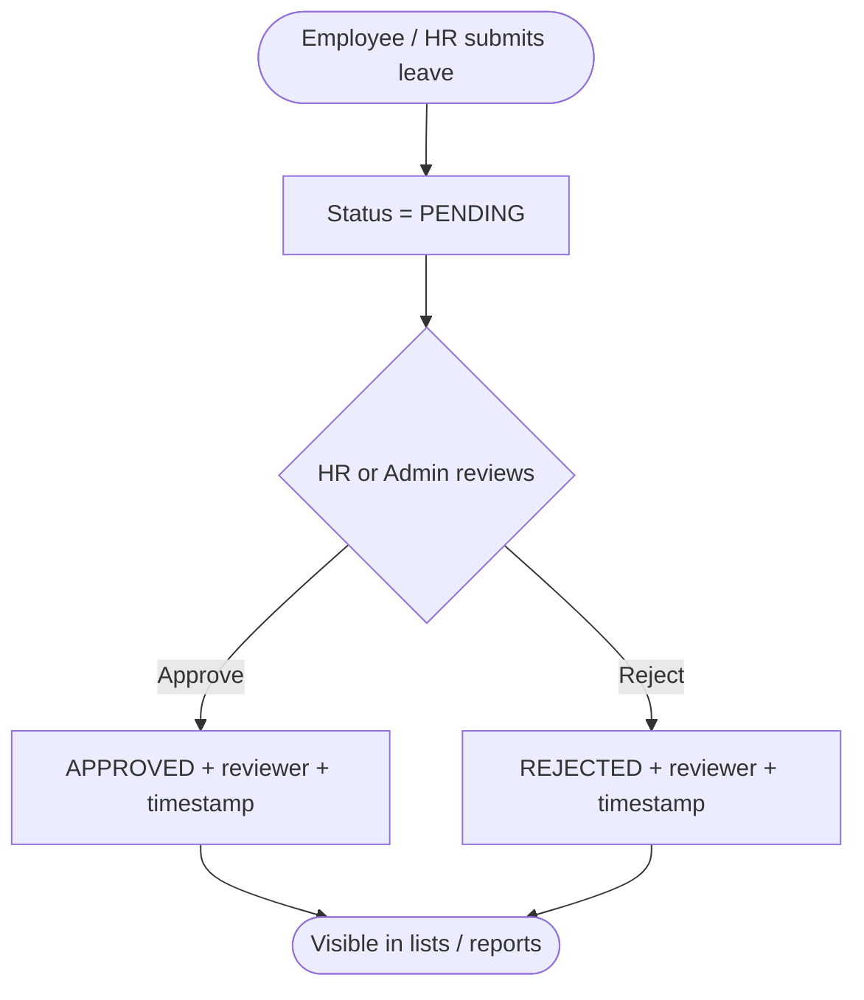
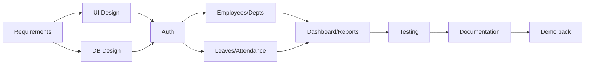

# Diagrams (paste into Word / draw.io)

## ER Diagram (Mermaid — render at https://mermaid.live)

## DFD Level-0 (Context)

## DFD Level-1

## Leave process flowchart

## PERT-style activity network

